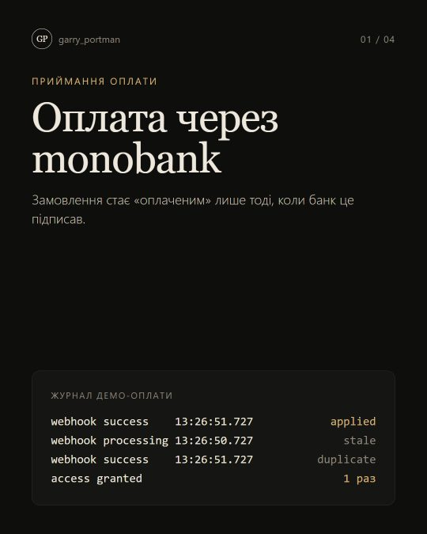
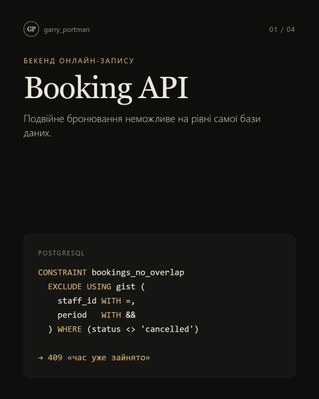
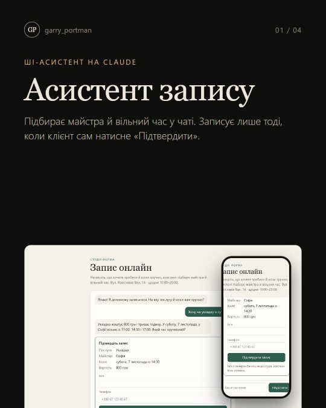
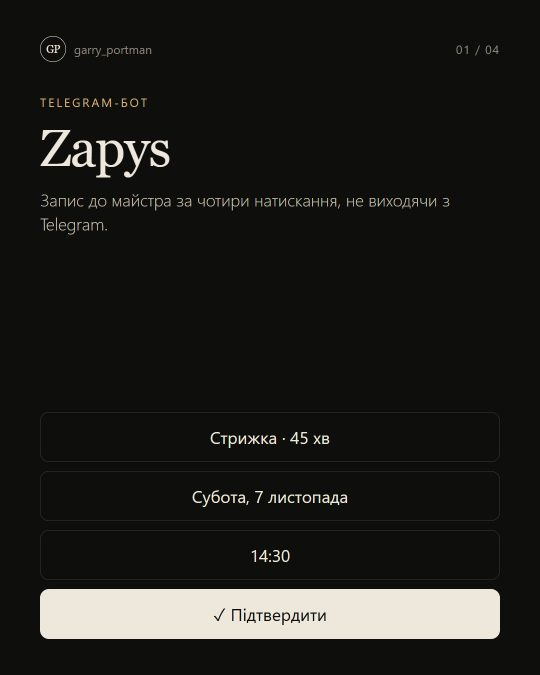

# Garry Portman — веброзробник

Роблю сайти, інтернет-магазини, сервіси онлайн-запису, Telegram-ботів та ШІ-асистентів для малого бізнесу й особистих брендів. Не «сторінку з кнопкою», а робочий інструмент: заявка доходить до власника, оплата проходить на сайті, а клієнт не губиться між директом і таблицею.

**Сайт:** [garry-portman.site](https://garry-portman.site) · **Instagram:** [@garry_portman](https://www.instagram.com/garry_portman/) · **Telegram:** [@garry_portman](https://t.me/garry_portman)

## Кейси

<table>
<tr>
<td width="33%" valign="top"> <b>Студія Форма</b> Онлайн-запис для салону: ролі клієнт / майстер / адміністратор, один слот не займуть двічі. Next.js · TypeScript · Vitest <a href="https://garry-portman.site/forma">Демо →</a></td>
<td width="33%" valign="top"> <b>Крамниця Полотно</b> Інтернет-магазин: залишки за розмірами, кабінети покупця й менеджера, замовлення в Telegram. Next.js · TypeScript · Vitest <a href="https://garry-portman.site/polotno">Демо →</a></td>
<td width="33%" valign="top"> <b>Черга</b> Сервіс заявок для команди: права ролей на сервері, SLA, історія змін, звіти. Next.js · TypeScript · Vitest <a href="https://garry-portman.site/cherha">Демо →</a></td>
</tr>
<tr>
<td valign="top"> <b>Бюро МЕЖА</b> Сайт архітектурного бюро з власною CMS і REST API: бюро публікує проєкти саме. Astro · TypeScript <a href="https://garry-portman.site/mezha">Демо →</a></td>
<td valign="top"> <b>Сайт особистого бренду</b> Сайт публічної людини зі строгою політикою безпеки. Lighthouse 98 / 100 / 100 / 100. Astro · CSP</td>
<td valign="top"> <b>Оплата через monobank</b> Платежі, що не губляться: підпис вебхуків, дублікати й події не по порядку, звірка з банком. TypeScript · Hono · SQLite</td>
</tr>
<tr>
<td valign="top"> <b>Booking API</b> REST API онлайн-запису: подвійну бронь відхиляє сама база даних. Перевірка в CI на PostgreSQL 17. PostgreSQL · Hono · OpenAPI</td>
<td valign="top"> <b>ШІ-асистент запису</b> Підбирає майстра й час у чаті, записує лише після підтвердження клієнта; особисті дані в модель не йдуть. Claude API · TypeScript</td>
<td valign="top"> <b>Zapys</b> Telegram-бот запису до салону: чотири натискання, без подвійних записів, сповіщення адміну. grammY · SQLite</td>
</tr>
</table>

**Ще проєкти:** [Amore Agency](https://amore.marketing) · [Таргет, який продає](https://target-mini-course.com.ua/) · [CHAINA](https://chaina.com.ua/) · [Бриз](https://garry-portman.site/bryz) · [OLSHEVSKA](https://garry-portman.site/olsha) · [Ліно](https://garry-portman.site/lino) — і інші на [garry-portman.site](https://garry-portman.site).

## Як я працюю

- **Безпека за замовчуванням:** підписані сесії, хеші паролів, перевірка прав на сервері, секрети лише в змінних середовища.
- **Тести на те, що найдорожче зламати:** подвійне бронювання, права ролей, сесії й паролі.
- **GitHub Actions на кожен push:** lint, тести, збірка — щоб зламане не потрапило в робочу гілку.
- **Передаю проєкт так, щоб ним можна було керувати:** README з запуском, демо-входами й поясненням рішень.

**Стек:** TypeScript · Next.js · React · Astro · Node.js · PHP · Laravel · Python · WordPress / WooCommerce · PostgreSQL · MySQL · SQLite · Docker · Telegram Bot API · Claude API · Vitest · Playwright · GitHub Actions

## Код

Репозиторії проєктів приватні. Вихідний код покажу на запит — напишіть у [Telegram](https://t.me/garry_portman) або [Instagram](https://www.instagram.com/garry_portman/).
