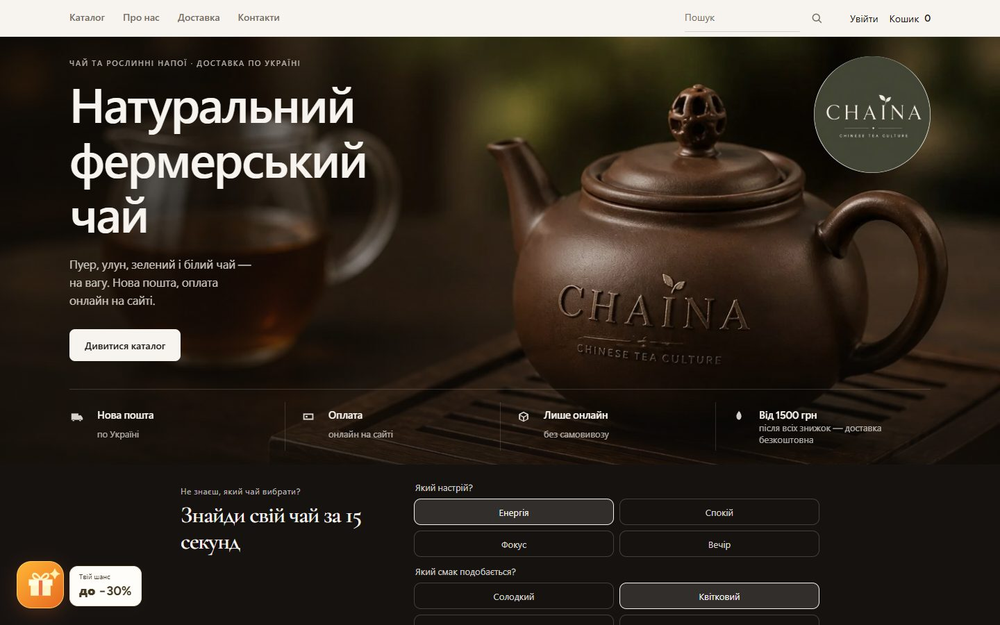
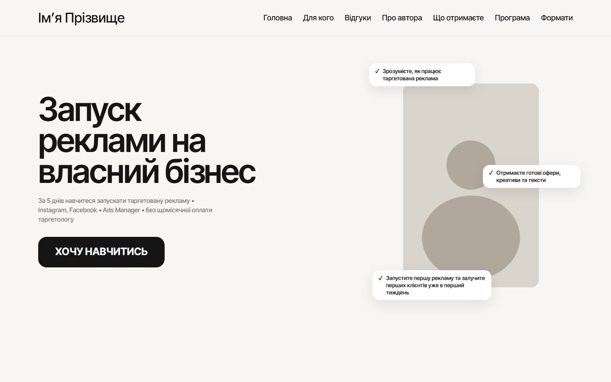
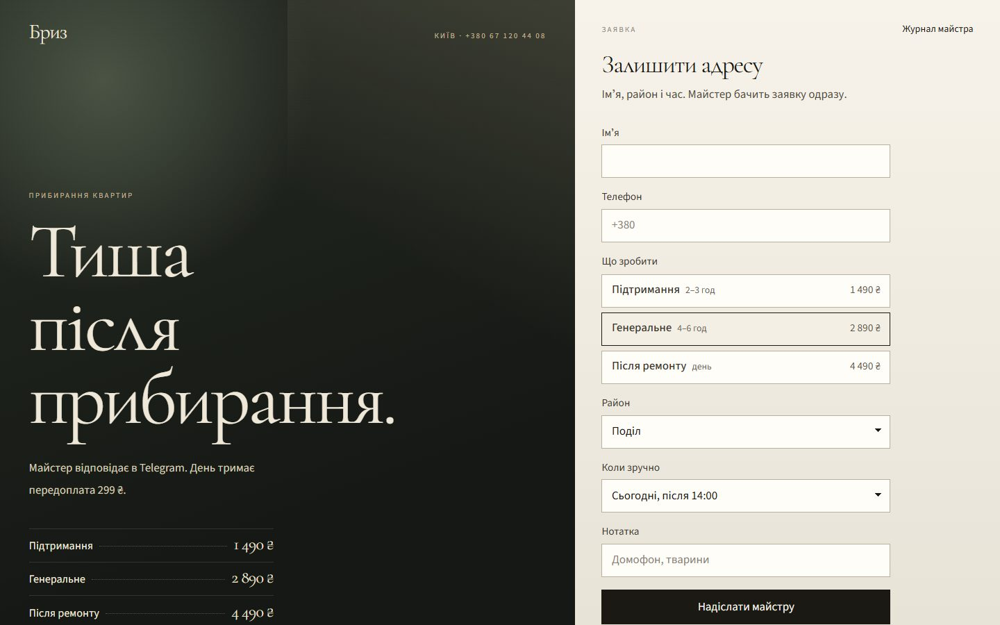
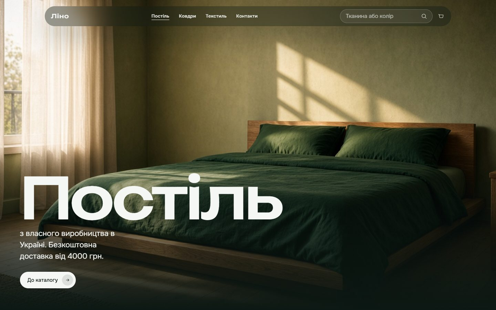

# Garry Portman — веброзробник

Роблю сайти, інтернет-магазини, сервіси онлайн-запису, Telegram-ботів та ШІ-асистентів для малого бізнесу й особистих брендів. Не «сторінку з кнопкою», а робочий інструмент: заявка доходить до власника, оплата проходить на сайті, а клієнт не губиться між директом і таблицею.

**Instagram:** [@garry_portman](https://www.instagram.com/garry_portman/) · **Telegram:** [@garry_portman](https://t.me/garry_portman)

Натисніть на проєкт, щоб побачити скриншоти сайту на комп'ютері й телефоні.

## Кейси

<table>
<tr>
<td width="33%" valign="top"> <b>Студія Форма</b> Онлайн-запис для салону: ролі клієнт / майстер / адміністратор, один слот не займуть двічі. Next.js · TypeScript · Vitest <a href="projects/forma.md">Дивитись →</a></td>
<td width="33%" valign="top"> <b>Крамниця Полотно</b> Інтернет-магазин: залишки за розмірами, кабінети покупця й менеджера, замовлення в Telegram. Next.js · TypeScript · Vitest <a href="projects/polotno.md">Дивитись →</a></td>
<td width="33%" valign="top"> <b>Черга</b> Сервіс заявок для команди: права ролей на сервері, SLA, історія змін, звіти. Next.js · TypeScript · Vitest <a href="projects/cherha.md">Дивитись →</a></td>
</tr>
<tr>
<td valign="top"> <b>Бюро МЕЖА</b> Сайт архітектурного бюро з власною CMS і REST API: бюро публікує проєкти саме. Astro · TypeScript <a href="projects/mezha.md">Дивитись →</a></td>
<td valign="top"> <b>Сайт особистого бренду</b> Сайт публічної людини зі строгою політикою безпеки. Lighthouse 98 / 100 / 100 / 100. Astro · CSP <a href="projects/personal-brand.md">Дивитись →</a></td>
<td valign="top"> <b>Оплата через monobank</b> Платежі, що не губляться: підпис вебхуків, дублікати й події не по порядку, звірка з банком. TypeScript · Hono · SQLite <a href="projects/checkout-monobank.md">Дивитись →</a></td>
</tr>
<tr>
<td valign="top"> <b>Booking API</b> REST API онлайн-запису: подвійну бронь відхиляє сама база даних. Перевірка в CI на PostgreSQL 17. PostgreSQL · Hono · OpenAPI <a href="projects/booking-api.md">Дивитись →</a></td>
<td valign="top"> <b>ШІ-асистент запису</b> Підбирає майстра й час у чаті, записує лише після підтвердження клієнта; особисті дані в модель не йдуть. Claude API · TypeScript <a href="projects/salon-assistant.md">Дивитись →</a></td>
<td valign="top"> <b>Zapys</b> Telegram-бот запису до салону: чотири натискання, без подвійних записів, сповіщення адміну. grammY · SQLite <a href="projects/zapys-bot.md">Дивитись →</a></td>
</tr>
</table>

## Ще сайти

<table>
<tr>
<td width="33%" valign="top"> <b>Amore Agency</b> Сайт рекламної агенції: кейси «бюджет → оборот» і калькулятор бюджету. <a href="projects/amore-agency.md">Дивитись →</a> · <a href="https://amore.marketing">amore.marketing</a></td>
<td width="33%" valign="top"> <b>CHAINA</b> Інтернет-магазин чаю на WooCommerce з оплатою на сайті. <a href="projects/chaina.md">Дивитись →</a> · <a href="https://chaina.com.ua/">chaina.com.ua</a></td>
<td width="33%" valign="top"> <b>Таргет, який продає</b> Лендинг курсу: квіз тарифів, оплата monobank, автоматичний доступ. <a href="projects/target-mini-course.md">Дивитись →</a> · <a href="https://target-mini-course.com.ua/">сайт</a></td>
</tr>
<tr>
<td valign="top"> <b>Бриз</b> Посадка під рекламу: заявка з UTM миттєво в Telegram майстра. <a href="projects/bryz.md">Дивитись →</a></td>
<td valign="top"> <b>OLSHEVSKA</b> Сайт особистого бренду майстра манікюру. <a href="projects/olsha.md">Дивитись →</a></td>
<td valign="top"> <b>Ліно</b> Легка вітрина постільної білизни без фреймворків. <a href="projects/lino.md">Дивитись →</a></td>
</tr>
</table>

## Як я працюю

- **Безпека за замовчуванням:** підписані сесії, хеші паролів, перевірка прав на сервері, секрети лише в змінних середовища.
- **Тести на те, що найдорожче зламати:** подвійне бронювання, права ролей, сесії й паролі.
- **GitHub Actions на кожен push:** lint, тести, збірка — щоб зламане не потрапило в робочу гілку.
- **Передаю проєкт так, щоб ним можна було керувати:** README з запуском, демо-входами й поясненням рішень.

**Стек:** TypeScript · Next.js · React · Astro · Node.js · PHP · Laravel · Python · WordPress / WooCommerce · PostgreSQL · MySQL · SQLite · Docker · Telegram Bot API · Claude API · Vitest · Playwright · GitHub Actions

## Код

Репозиторії проєктів приватні. Вихідний код покажу на запит — напишіть у [Telegram](https://t.me/garry_portman) або [Instagram](https://www.instagram.com/garry_portman/).
