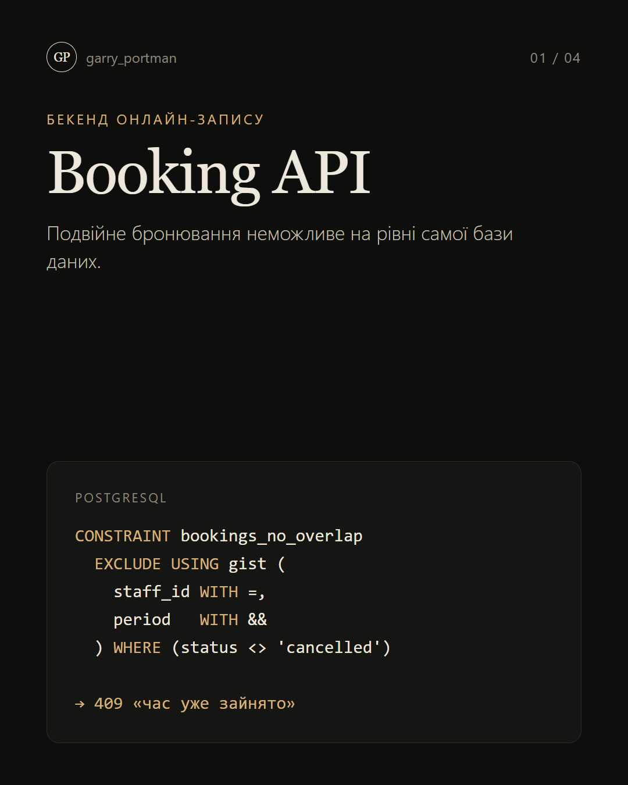
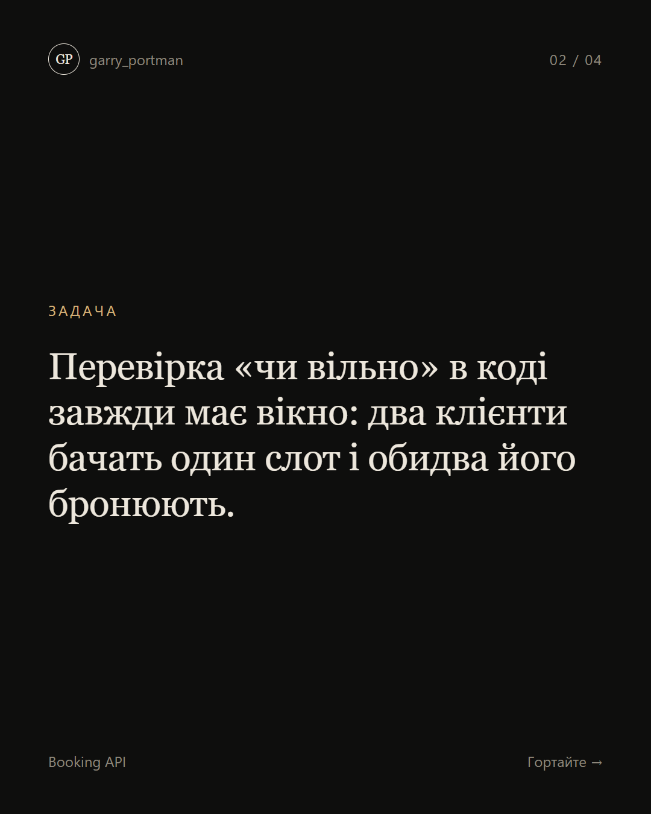
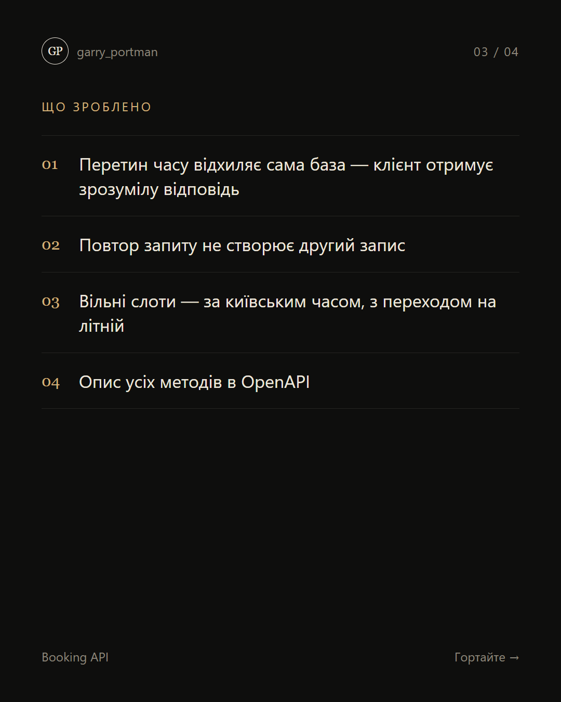
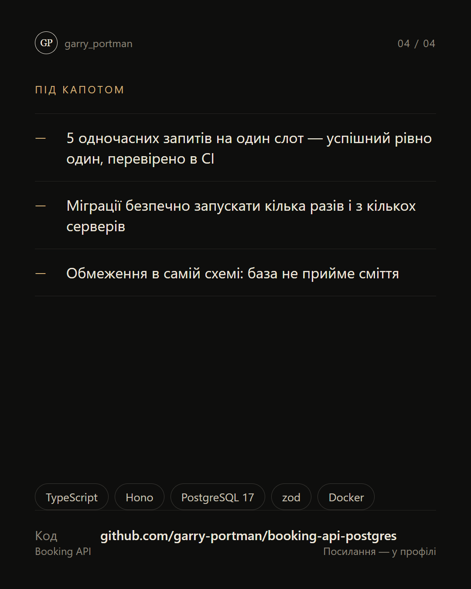

# Booking API на PostgreSQL

**API онлайн-запису, де подвійну бронь відхиляє сама база даних — навіть коли пʼять запитів приходять одночасно.**

  
  
  
  

## Що зроблено

- Перетин часу відхиляє сама база — клієнт отримує зрозумілу відповідь
- Повтор запиту не створює другий запис
- Вільні слоти — за київським часом, з переходом на літній

**Стек:** PostgreSQL · Hono · OpenAPI

---

[← Усі проєкти](../README.md) · Потрібне схоже рішення — пишіть у [Telegram](https://t.me/garry_portman) або [Instagram](https://www.instagram.com/garry_portman/).
