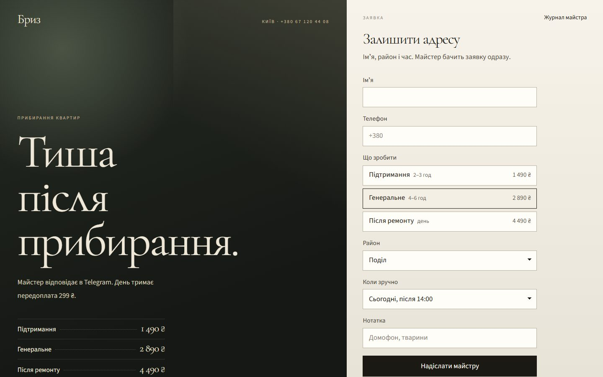
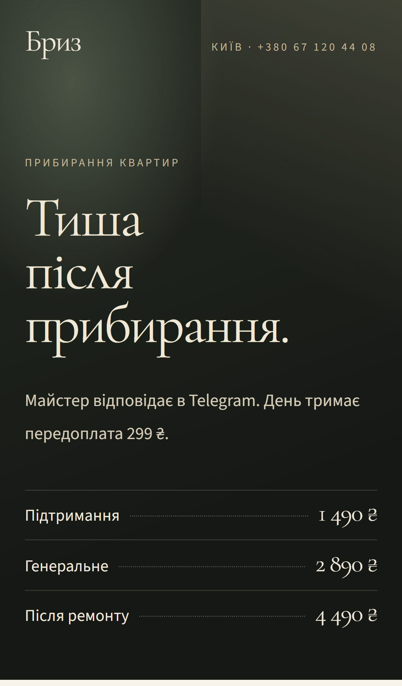

# Бриз — посадка під рекламу, яка не губить заявки

**Клік з реклами одразу стає заявкою в Telegram майстра — з джерелом, кампанією і передоплатою за слот.**

  
  

## Що зроблено

- Заявка з UTM миттєво в Telegram майстра
- Передоплата за слот прямо на сторінці
- Одна сторінка під рекламу замість переписки в директі

**Стек:** Next.js · TypeScript

---

[← Усі проєкти](../README.md) · Потрібне схоже рішення — пишіть у [Telegram](https://t.me/garry_portman) або [Instagram](https://www.instagram.com/garry_portman/).
