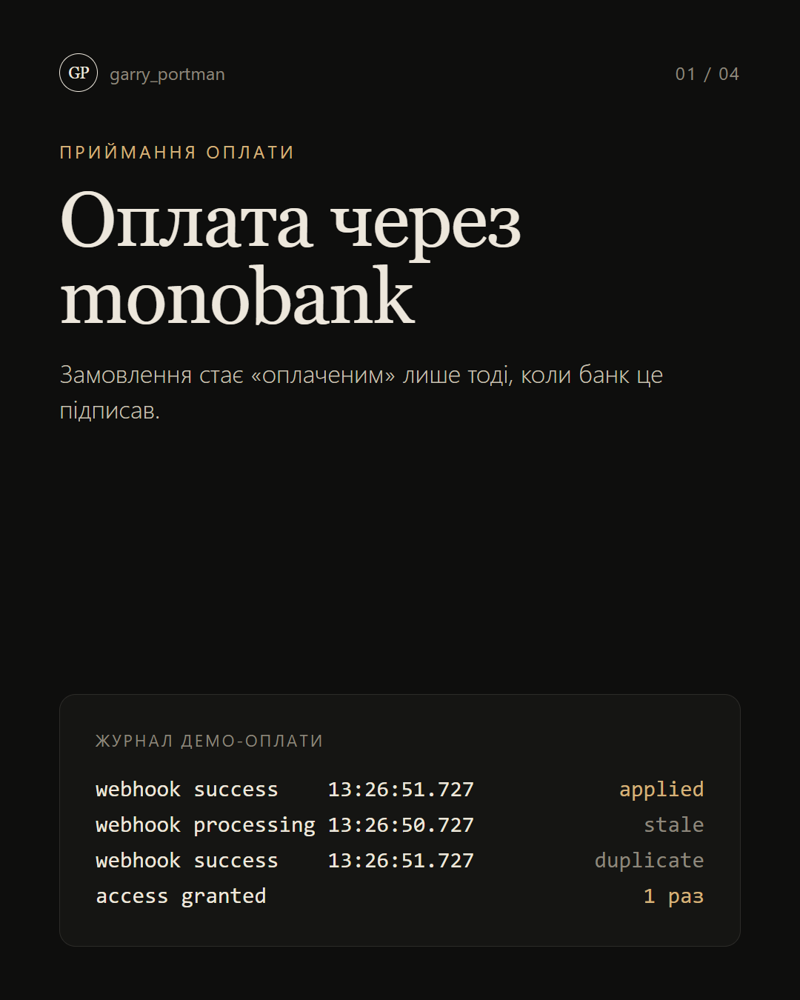
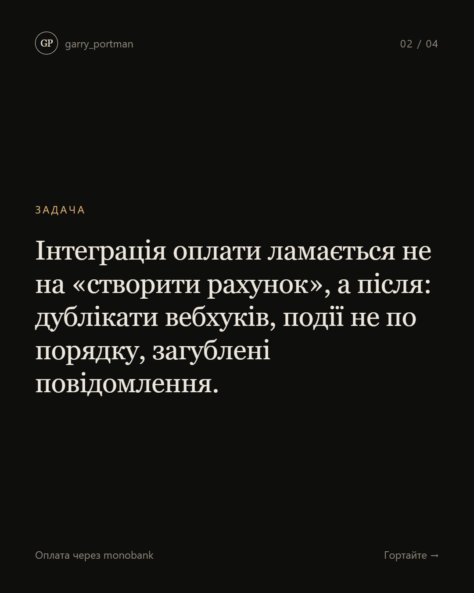
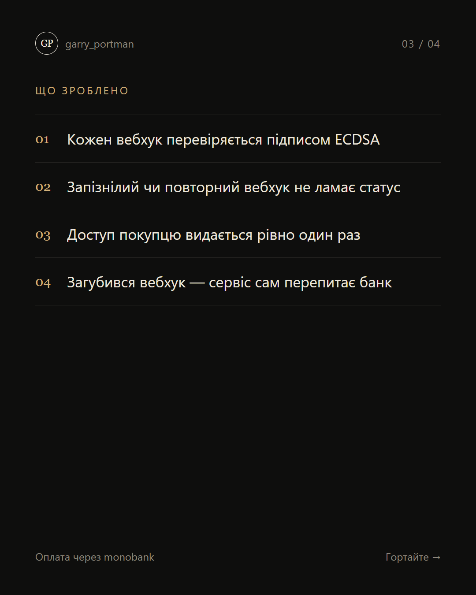
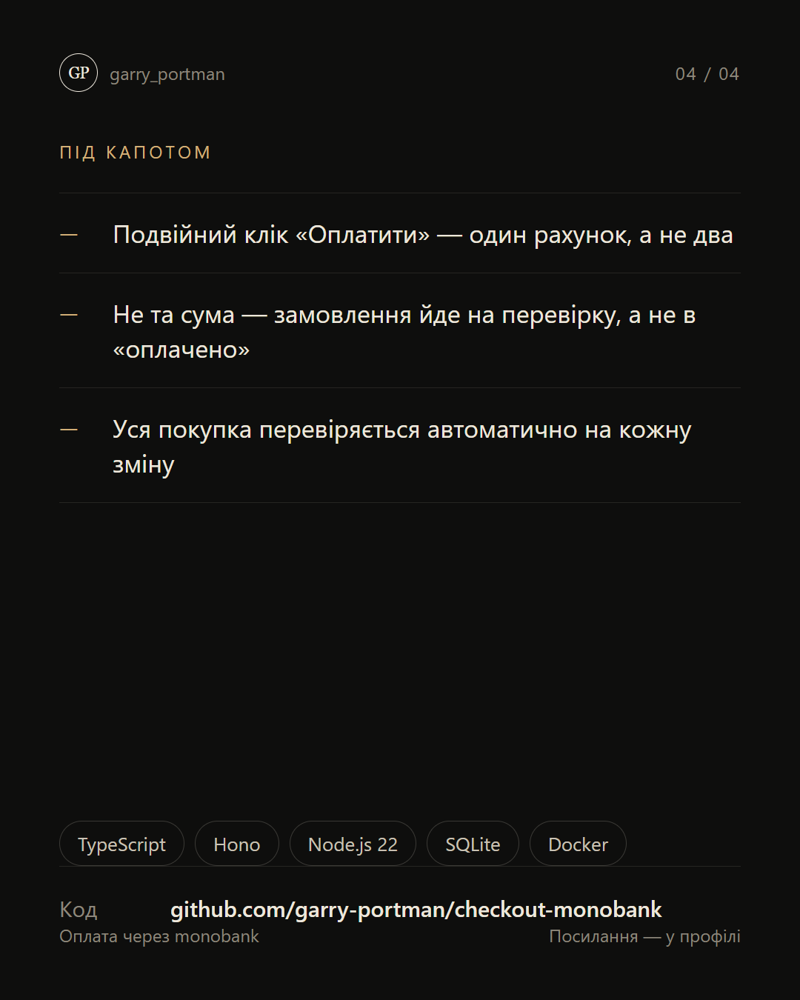

# Оплата через monobank

**Приймання оплати, яке не губить гроші: підпис кожного вебхука, захист від дублікатів і звірка з банком.**

  
  
  
  

## Що зроблено

- Кожен вебхук перевіряється підписом ECDSA
- Запізнілий чи повторний вебхук не ламає статус
- Доступ покупцю видається рівно один раз

**Стек:** TypeScript · Hono · SQLite

---

[← Усі проєкти](../README.md) · Потрібне схоже рішення — пишіть у [Telegram](https://t.me/garry_portman) або [Instagram](https://www.instagram.com/garry_portman/).
