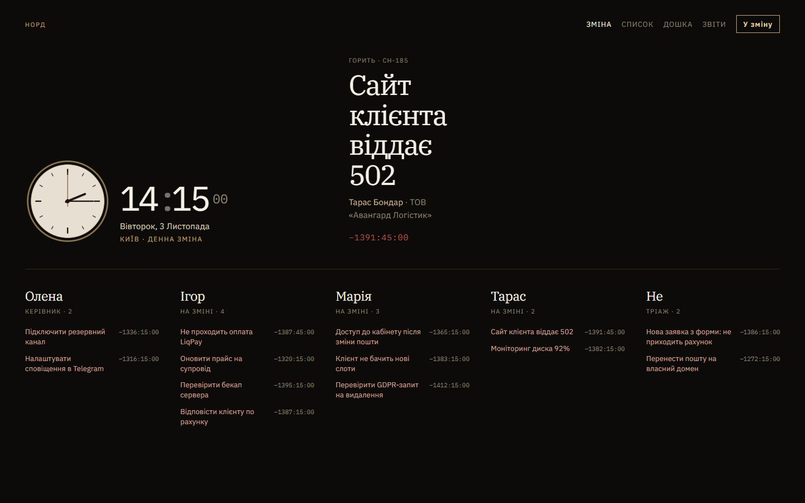
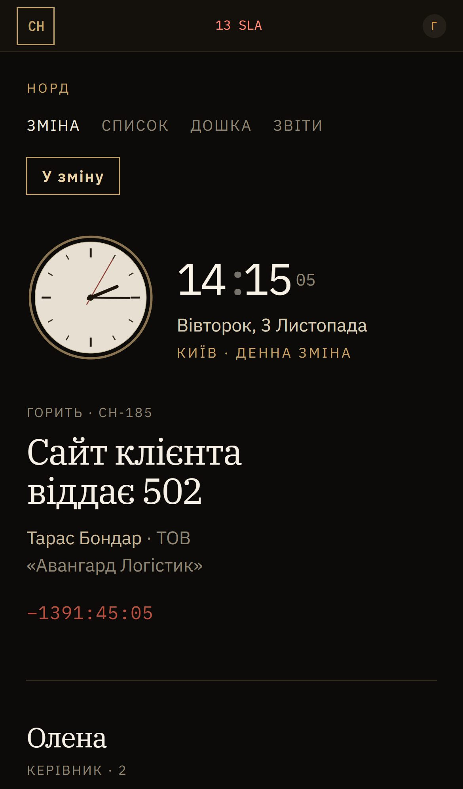

# Черга — робоча черга заявок для команди

**Керівник бачить усю зміну, виконавець — тільки свої задачі. Нічого не губиться між чатами, а кожна зміна статусу лишає слід в історії.**

  
  

## Що зроблено

- Дошка зміни, фільтри «мої / відкриті / усі» і пошук
- Пріоритети, дедлайни й контроль SLA
- Історія кожної заявки: хто, коли й що змінив

**Стек:** Next.js · TypeScript · Vitest

---

[← Усі проєкти](../README.md) · Потрібне схоже рішення — пишіть у [Telegram](https://t.me/garry_portman) або [Instagram](https://www.instagram.com/garry_portman/).
