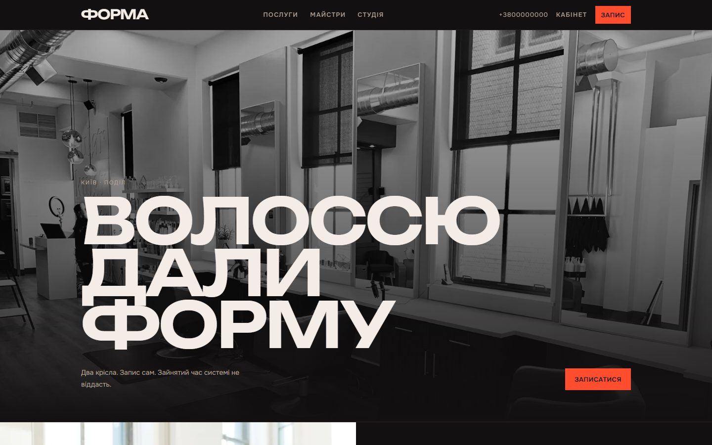
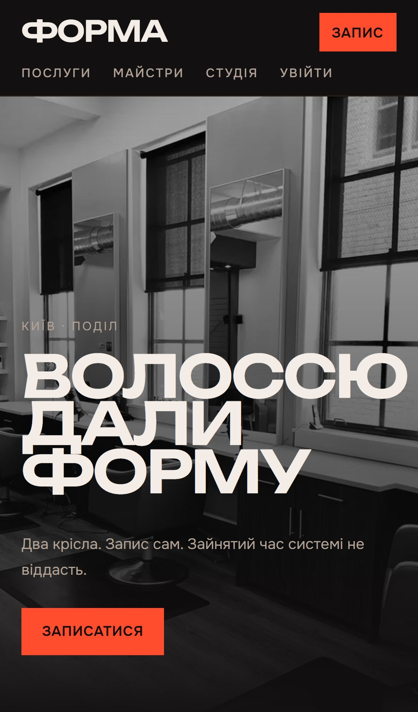

# Студія Форма — онлайн-запис без накладок

**Клієнт бере вільний час за хвилину, майстер бачить свій день, адміністратор — усю студію. Один слот неможливо зайняти двічі — навіть двома одночасними запитами.**

  
  

## Що зроблено

- Клієнт обирає послугу й майстра і бачить лише справді вільні слоти
- Майстер бачить свій день, адміністратор — усю студію з фільтрами
- Статуси тільки дозволеними кроками: очікує → підтверджено → виконано

**Стек:** Next.js · TypeScript · Vitest

---

[← Усі проєкти](../README.md) · Потрібне схоже рішення — пишіть у [Telegram](https://t.me/garry_portman) або [Instagram](https://www.instagram.com/garry_portman/).
