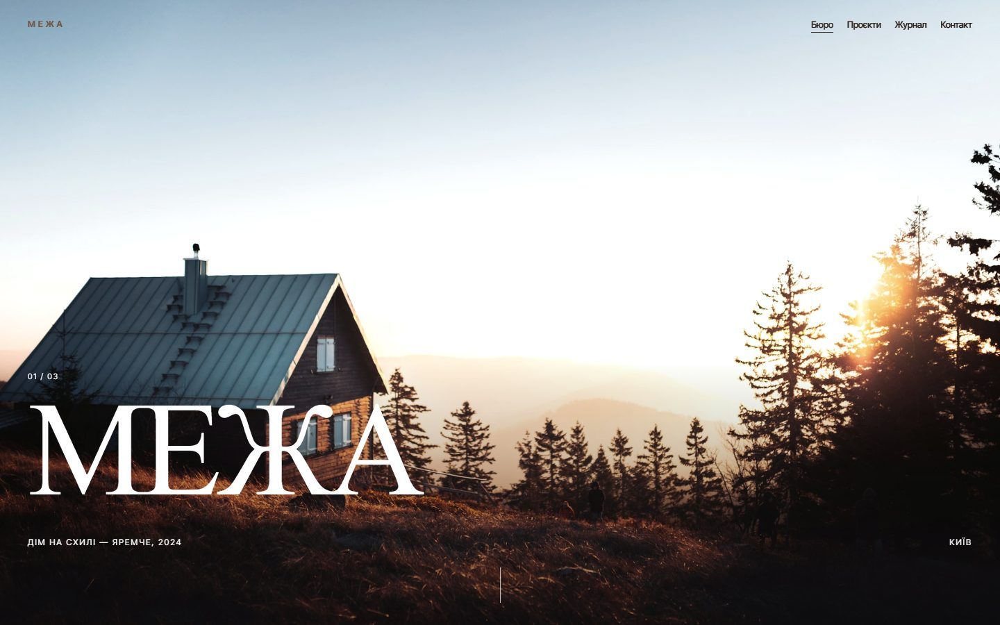
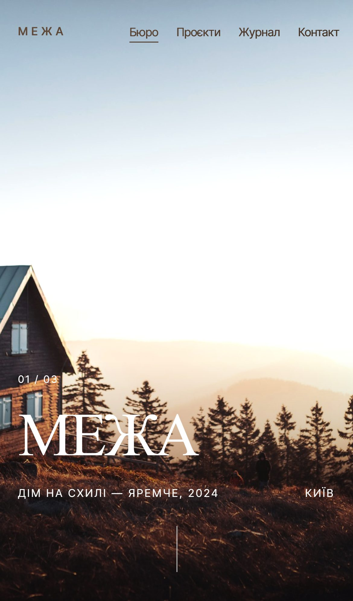

# Бюро МЕЖА — сайт архітектурного бюро з власною CMS

**Бюро саме публікує проєкти й нотатки — без розробника і без правок у шаблонах.**

  
  

## Що зроблено

- Проєкти, нотатки й сторінка бюро з великими фото
- Власна адмінка для проєктів, нотаток і налаштувань
- REST API для того самого контенту — під будь-який інший фронтенд

**Стек:** Astro · TypeScript

---

[← Усі проєкти](../README.md) · Потрібне схоже рішення — пишіть у [Telegram](https://t.me/garry_portman) або [Instagram](https://www.instagram.com/garry_portman/).
