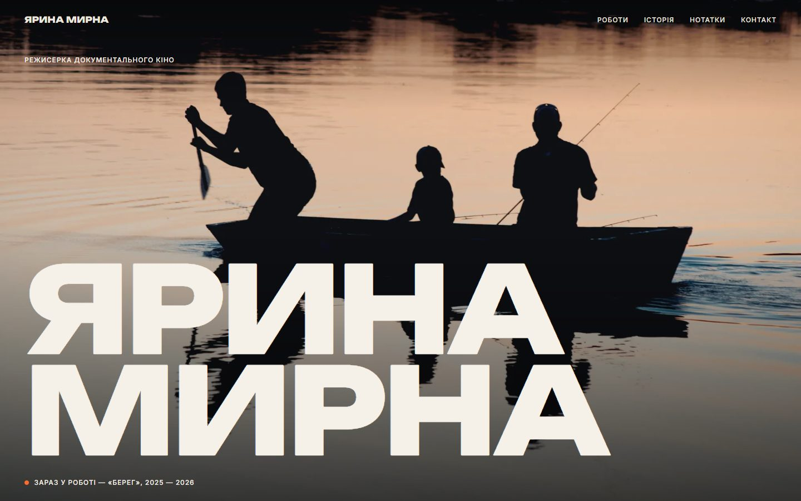
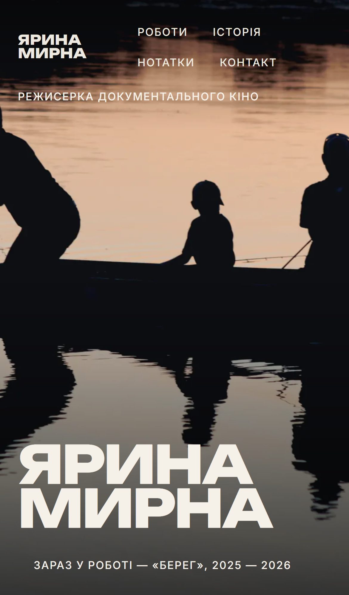
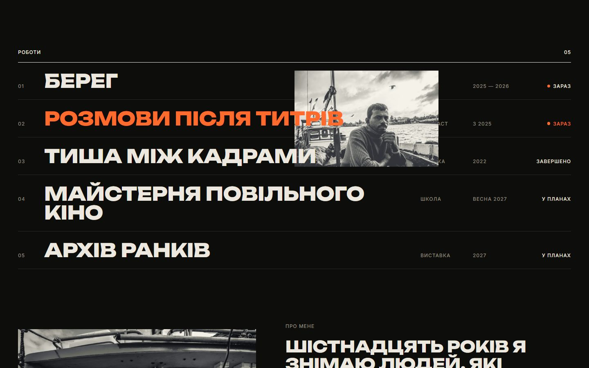
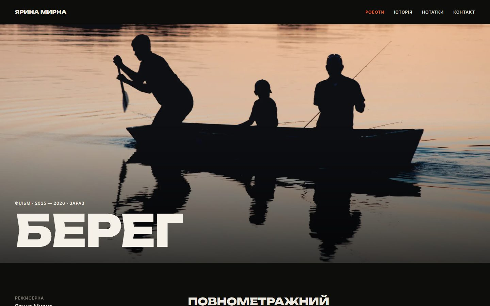
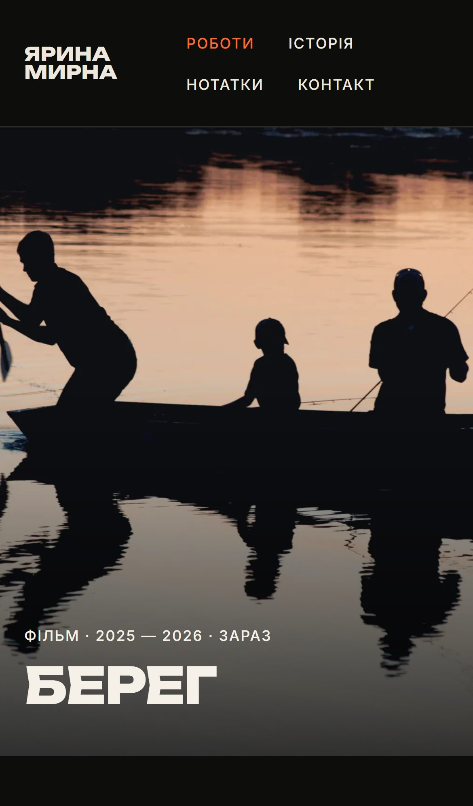
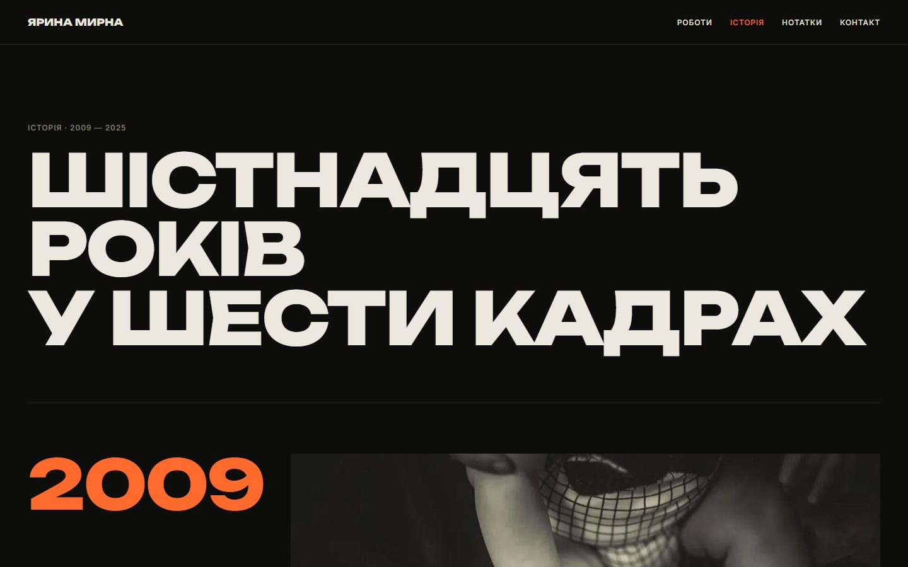
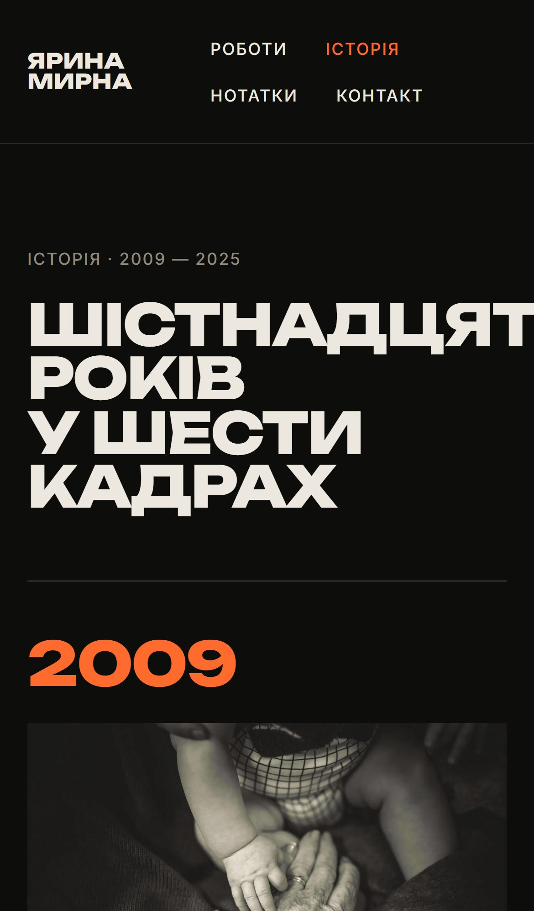
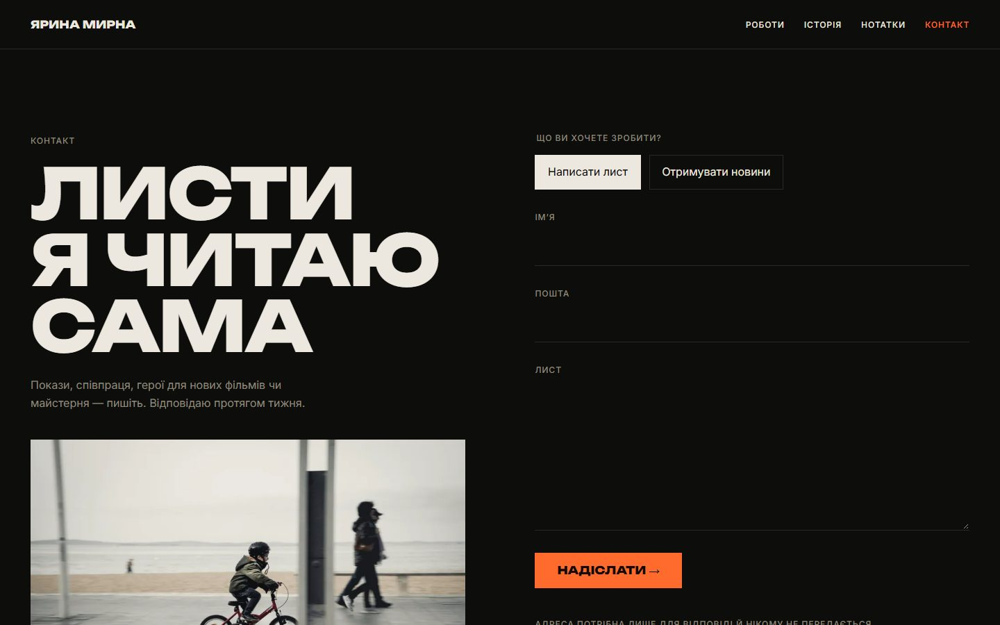
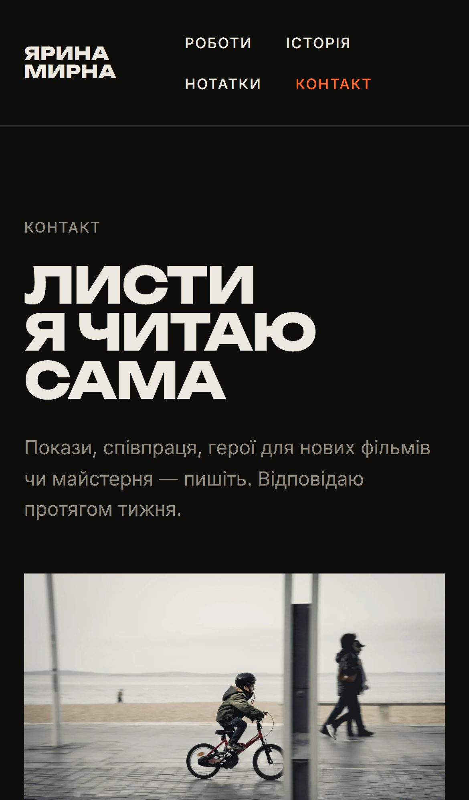

# Сайт особистого бренду — концепт для публічної людини

**Сайт режисерки, на якому головне — її кіно: кадр на весь екран, імʼя як титр фільму, індекс робіт, історія становлення. Lighthouse 98 / 100 / 100 / 100.**

  
  

### Сторінка проєкту

  
  

### Історія становлення

  
  

### Контакти

  
  

## Що зроблено

- Перший екран — кадр на всю ширину, імʼя як титр
- Індекс робіт: кадр зʼявляється при наведенні
- Історія становлення шістьма кадрами
- Суворі заголовки безпеки й форма, захищена від спаму

**Стек:** Astro · TypeScript · CSP

---

[← Усі проєкти](../README.md) · Потрібне схоже рішення — пишіть у [Telegram](https://t.me/garry_portman) або [Instagram](https://www.instagram.com/garry_portman/).
