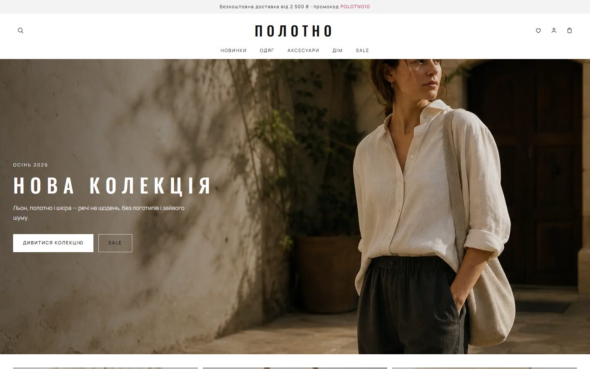

# Крамниця Полотно — інтернет-магазин, яким можна керувати

**Повноцінний магазин одягу: каталог, склад, замовлення й кабінет менеджера в одному місці, а нове замовлення одразу приходить у Telegram.**

  
  

## Що зроблено

- Каталог із фільтрами й наявністю за розмірами
- Кошик, промокод, вибір доставки й оплати
- Кабінет покупця: історія замовлень, обране
- Кабінет менеджера: статуси й склад

**Стек:** Next.js · TypeScript · Vitest

---

[← Усі проєкти](../README.md) · Потрібне схоже рішення — пишіть у [Telegram](https://t.me/garry_portman) або [Instagram](https://www.instagram.com/garry_portman/).
