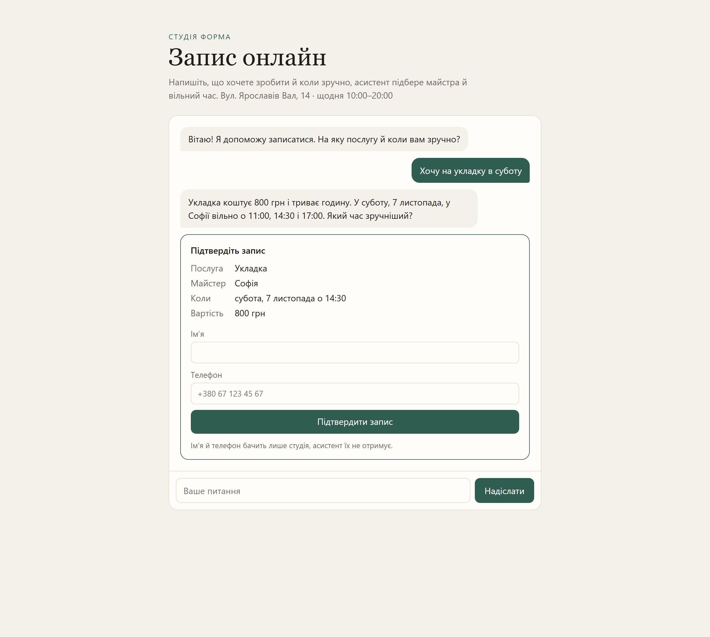
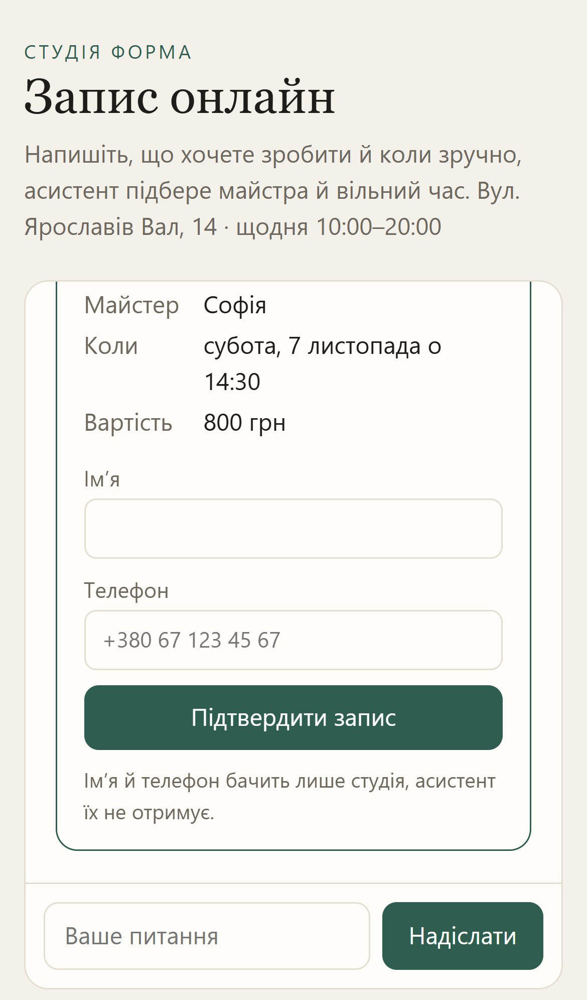

# ШІ-асистент запису для салону

**Відповідає й підбирає час, але записує лише після підтвердження клієнта, а його телефон до моделі не потрапляє.**

  
  

## Що зроблено

- Відповідає про послуги, ціни й майстрів — лише з даних студії
- Пропонує вільний час і готує картку запису
- Запис створюється тільки після підтвердження клієнтом

**Стек:** Claude API · TypeScript · Hono

---

[← Усі проєкти](../README.md) · Потрібне схоже рішення — пишіть у [Telegram](https://t.me/garry_portman) або [Instagram](https://www.instagram.com/garry_portman/).
