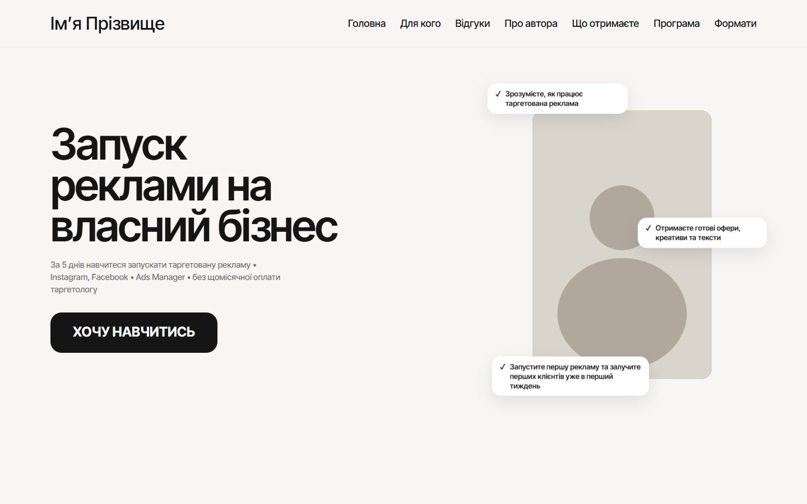
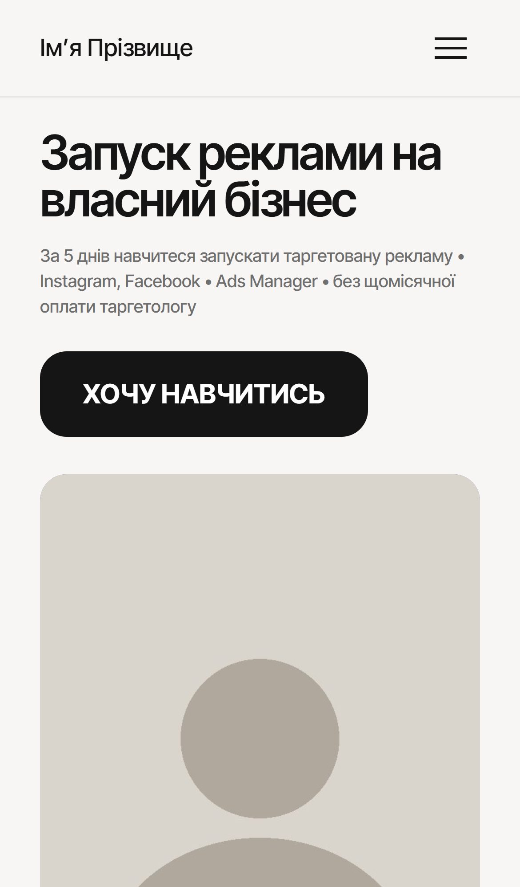

# Таргет, який продає — лендинг міні-курсу

**Лендинг веде від «а мені це підходить?» до оплати без менеджера: квіз підбирає тариф, оплата через monobank, доступ приходить на пошту автоматично.**

**Живий сайт:** https://target-mini-course.com.ua/

  
  

## Що зроблено

- Квіз підбору тарифу й калькулятор бюджету
- Оплата monobank і автоматичний доступ
- Авторка сама змінює ціну й таймер

**Стек:** WordPress · WooCommerce · PHP

---

[← Усі проєкти](../README.md) · Потрібне схоже рішення — пишіть у [Telegram](https://t.me/garry_portman) або [Instagram](https://www.instagram.com/garry_portman/).
