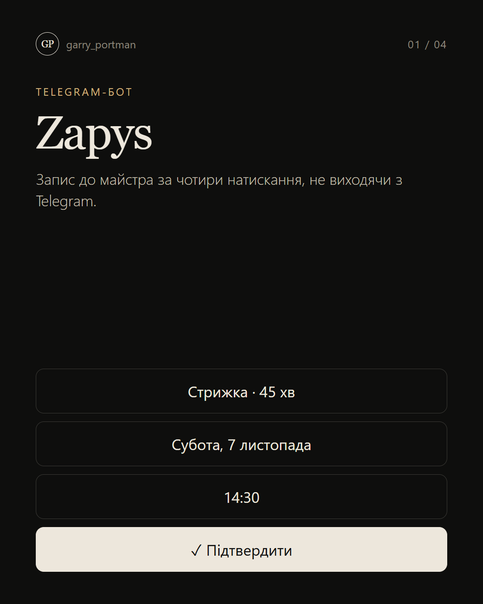
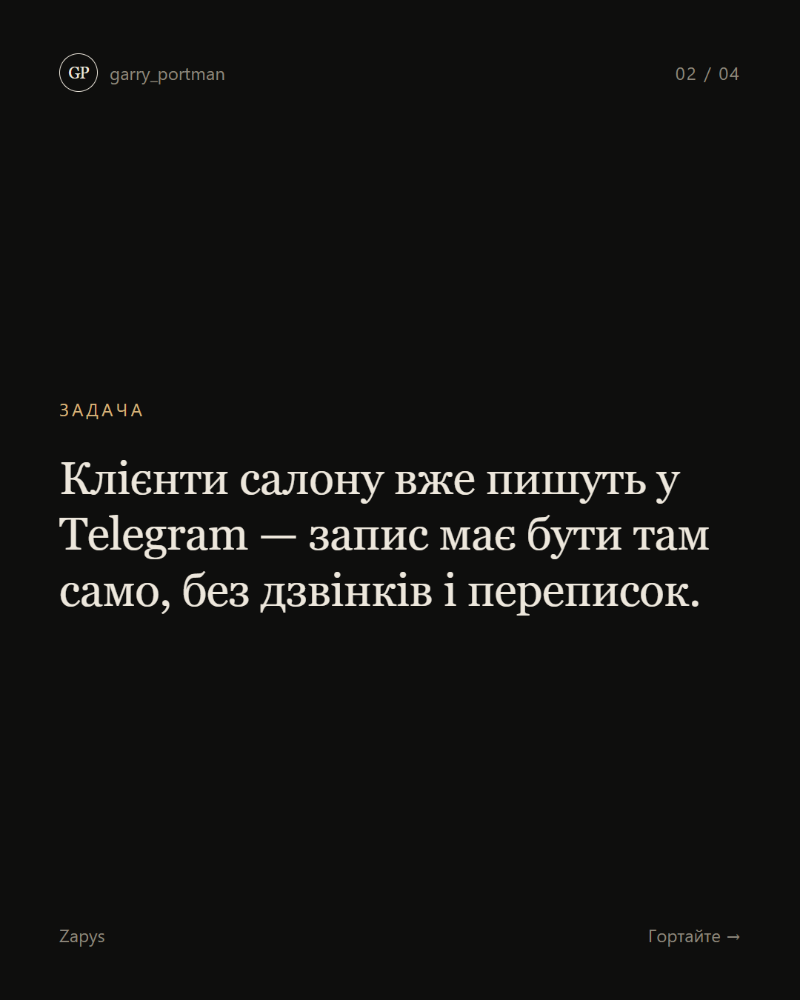
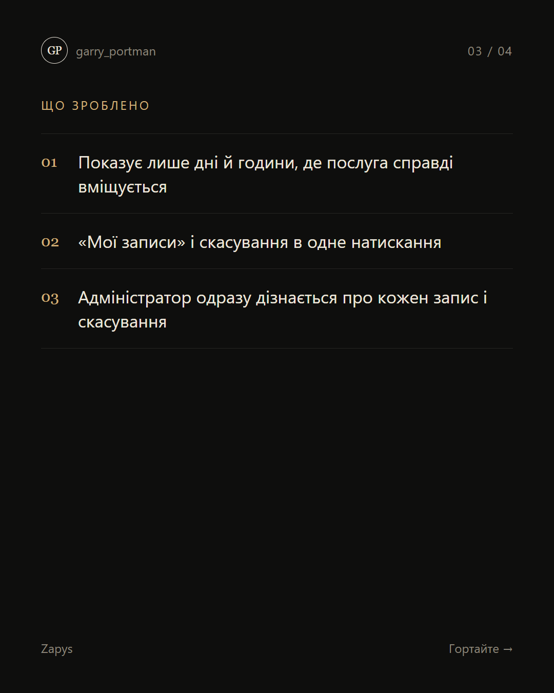
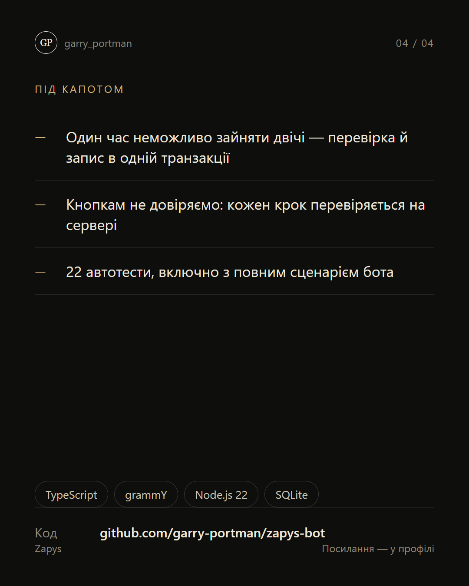

# Zapys — Telegram-бот запису до салону

**Чотири натискання, жодних подвійних записів і сповіщення адміністратору.**

  
  
  
  

## Що зроблено

- Показує лише дні й години, де послуга справді вміщується
- «Мої записи» і скасування в одне натискання
- Адміністратор одразу дізнається про кожен запис і скасування

**Стек:** grammY · SQLite

---

[← Усі проєкти](../README.md) · Потрібне схоже рішення — пишіть у [Telegram](https://t.me/garry_portman) або [Instagram](https://www.instagram.com/garry_portman/).
